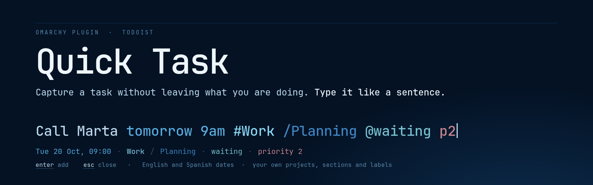
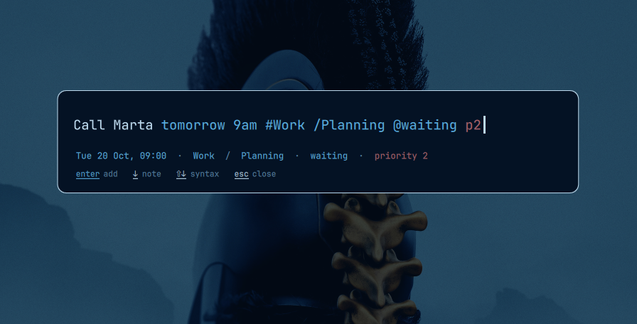
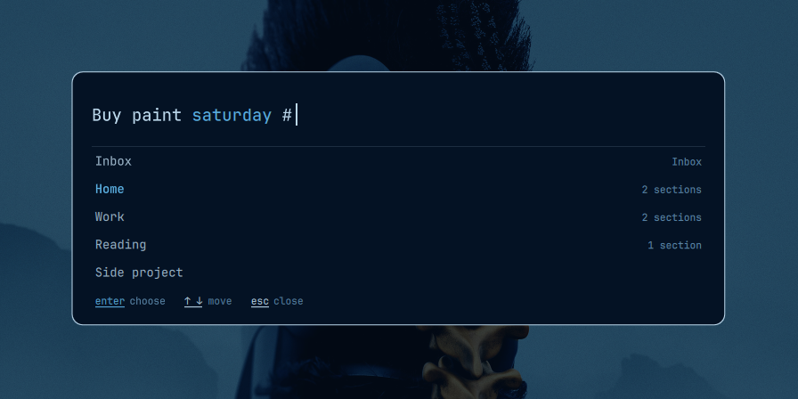
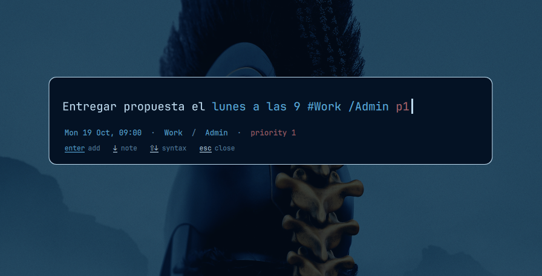

# Quick Task



Capture a Todoist task from anywhere in Omarchy without leaving what you are doing. Press a key, type a sentence, press `Enter`. Dates, projects, sections, labels and priority are read out of the sentence as you type, in English and Spanish, and your own projects, sections and labels autocomplete.



Add-only: it creates tasks and never reads or changes the ones you have.

## What it does

- **Reads the sentence.** `tomorrow 9am`, `tmr`, `31 oct`, `31 de octubre`, `fri`, `lunes a las 9` become a date; `#Work`, `/Planning`, `@waiting` and `p2` become a project, section, label and priority. What was understood is shown in colour, with one quiet line under the sentence saying it in words.
- **Autocompletes from your account.** `#` lists your projects, `/` the sections of the project before it, `%` or `@` your labels, `+` that project's collaborators. `Enter` or `Tab` picks, the arrows move, `Esc` closes the list.
- **Never in the way.** The window opens on one field. Everything else appears once there is something to show, and the Todoist data is cached so it opens instantly.
- **Takes the theme.** Colours, font, spacing and corner radius come from the live Omarchy theme.





The images come from an invented account (`tools/screenshots.py`).

## Install

```sh
omarchy plugin add https://github.com/danitrrga/omarchy-quick-task.git --enable
```

Needs the system `python3` at `/usr/bin/python3` (standard library only, no packages).

### Connect Todoist

Create a personal API token in Todoist under Settings → Integrations → Developer. Quick Task reads it from the `TODOIST_API_TOKEN` environment variable of the shell, or from the `token` field of `~/.config/tod.cfg` (the config file of the [`tod`](https://github.com/alanvardy/tod) client, JSON). Keep that file mode `0600`.

### Open it with a key

The plugin does not touch your Hyprland config. Add a binding:

```lua
-- ~/.config/hypr/bindings.lua
o.bind("SUPER + SHIFT + SEMICOLON", "Quick task (Todoist)", "omarchy-shell shell summon io.github.danitrrga.quick-task '{}'")
```

### Remove

```sh
omarchy plugin remove io.github.danitrrga.quick-task
```

Then delete the binding and, to erase what it cached, `~/.cache/quick-task/`.

## Using it

| Key | Does |
| --- | --- |
| `Enter` | add the task (or pick the highlighted entry when a list is open) |
| `Tab` | pick the highlighted entry |
| `↑` `↓` | move in the list |
| `↓` | with no list open: add a note (description) |
| `⇧` `↓` | show the syntax reminder |
| `Esc` | close the list; a second `Esc` closes the window |
| `Backspace` | right after a coloured word: keep that word as plain text |

Click any item on the detail line to keep it as plain text too. After a task is added the window closes and a notification confirms it.

### What is recognised

| In the sentence | Becomes |
| --- | --- |
| `today`, `tomorrow`, `tmr`, `2moro`, `hoy`, `mañana`, `pasado mañana` | a date |
| `mon`, `tues`, `lunes`, `this friday`, `el próximo martes` | the next such day |
| `21st`, `el 21` | the next 21st |
| `31 oct`, `oct 31`, `31 de octubre`, `31 oct 2027`, `31/10`, `5/10/26` | that date (a past one means next year) |
| `at 5pm`, `9am`, `a las 9` after a date | its time |
| `#Work` · `/Planning` · `@waiting` or `%waiting` · `p1` to `p4` | project · section · label · priority |

Names with spaces and emoji work (`#Side project`, `/Rutinas 🔁`). An unknown `#name` stays plain text, exactly as in Todoist, and the detail line says "not found". Only the last date, project, section and priority in a sentence count.

### Todoist Pro

Reminders (`!30 min before`) and deadlines (`{oct 30}`) are Todoist Pro features. On a free account the `!` list is not offered, their detail items say "needs Todoist Pro", and if you submit one anyway Todoist's own refusal is shown. Plain dates never need braces.

### How the names are applied

Todoist's quick-add endpoint reads only single-word names, and only `@label`, so `#Side project`, `/Rutinas 🔁` or `%waiting` would be left in the title. Quick Task therefore matches mentions to your cached account itself (ignoring case and accents), takes them out of the text, adds the task, then moves it and sets its labels by id. If that second step fails the task still exists, in Inbox, and the window says so.

## What leaves your machine

Only requests to `api.todoist.com`, authenticated with your token:

- the task text, note and the ids above, when you add a task;
- reads of your projects, sections, labels, collaborators and plan, to fill the lists.

Nothing else is sent anywhere. The token is never written to a log, an error message, a process argument or the plugin's IPC state.

## What it stores

- `~/.cache/quick-task/account.json` (mode `0600`): the names and ids of your projects, sections, labels and collaborators, refreshed in the background when older than five minutes. No task is stored.
- Your token stays where you keep it (`tod.cfg` or the environment); Quick Task only reads it.

## What it runs

Every command the plugin starts, nothing else:

- `/usr/bin/python3 -I -B <plugin folder>/helper/quick-task parse|add|account|sync`, which makes the HTTPS requests above;
- `<omarchy>/bin/omarchy-notification-send` after a task is added.

## Development

```sh
uv venv --python 3.14 ~/.cache/venvs/quick-task    # outside the repo: the plugin validator rejects symlinks
VIRTUAL_ENV=~/.cache/venvs/quick-task uv pip install pytest pillow
~/.cache/venvs/quick-task/bin/python -m pytest -q
omarchy plugin validate .
```

`omarchy-shell io.github.danitrrga.quick-task state` shows what the overlay computed; `open`, `type`, `key`, `pick`, `submit` and `close` drive the same code a key press does. Regenerate the screenshots with `python3 tools/screenshots.py` (workspace 5, invented account) and the banner with the command at the top of `tools/banner.html`. The behaviour spec is in [docs/spec.md](docs/spec.md); `CLAUDE.md` has the working notes.

## License

MIT, see [LICENSE](LICENSE).
